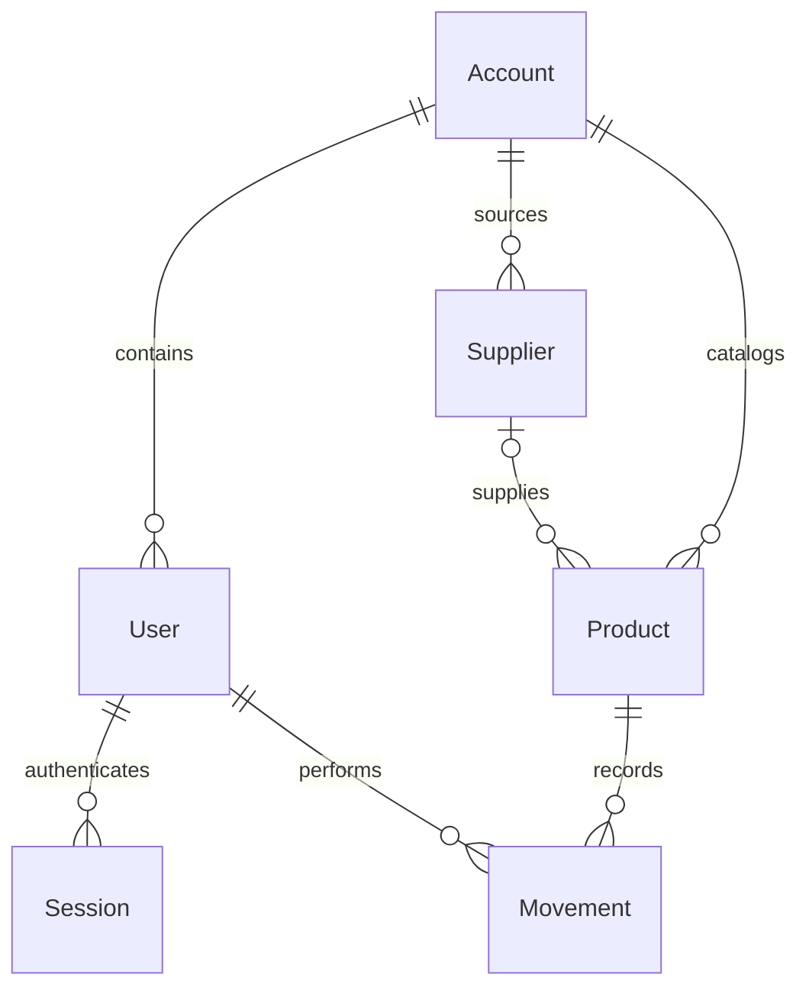

# Architecture and domain rules

## Problem and requirements

Small operations need to know which products are available, what requires replenishment and who changed a balance. A useful inventory tool must protect stock integrity when two people withdraw units or a network request is retried.

Functional requirements: workspace catalog, suppliers, search/filter/pagination, stock movements, low-stock queue, actor-attributed history, summary valuation and safe CSV export. Non-functional requirements: atomic writes, no negative balances, idempotency, server-side roles, tenant isolation, bounded lists, responsive UI and request/concurrency/browser tests.

## Transaction boundary

StockMove accepts a product, actor, direction, quantity, reference and request key. It validates the input, locks the product row and checks the workspace-wide idempotency key. An identical recorded operation is replayed without changing stock. A conflicting payload is rejected. Otherwise it computes the new balance and saves the product and movement inside the same transaction.

The row lock prevents concurrent withdrawals from reading the same old balance. The database balance constraint is a final safeguard. The unique workspace/key index protects against racing inserts across different products, with transaction rollback preserving the corresponding product balance.

Movements store actor, quantity, direction, reference and balance_after; their records are read-only through Active Record and have no edit/delete routes. This is application-level history, not a tamper-proof ledger against privileged SQL access. Direct database writes can bypass cross-workspace model/service checks and reconciliation rules; database administration remains trusted.

## Modeling and bounds

Products have an uppercase normalized SKU unique in their workspace. They start at zero, and have a location, optional same-workspace supplier, minimum quantity and BRL-cent unit cost. The catalog is capped at 1,000 products under an account lock. Product quantities/minimums are capped at 1,000,000 and cost at 1,000,000 cents. These limits keep the maximum current inventory valuation below JavaScript's exact-integer bound.

There is no direct balance setter in the public API. Strong parameters ignore client-supplied on_hand/account_id. Each legitimate stock change goes through the service. Model validations produce useful messages; PostgreSQL constraints and foreign keys enforce core integrity. A failed withdrawal creates no movement and changes no balance.

## Queries and UI

Search uses escaped ILIKE patterns over name/SKU. Balance and supplier filtering run server-side. Catalog/history pages hold 20 rows. The product modal returns its latest 50 movements. Summary cards use SQL counts/sums and 30-day direction totals; a numeric aggregate is converted to an integer before JSON serialization.

TanStack Query owns server state and invalidates catalog, summaries and movement/history queries after success. The form retains an idempotency key for retries and generates a new key after input changes. Native dialogs handle modal focus/Escape; mobile navigation and reduced-motion preferences are supported.

## Authentication and authorization

BCrypt protects passwords. Login issues a random opaque 12-hour session credential; only its SHA-256 digest is persisted. sessionStorage contains the credential, and logout revokes it server-side. Owner can create products/suppliers and move stock. Operator can move stock but cannot change the catalog. Viewer can read/export only.

All lookups are scoped through the authenticated account, including supplier/product filters. Role checks run on the API. This is application-level tenant scoping, not PostgreSQL row-level security. Login throttling uses process-local memory; scale-out hosting needs a shared limiter.

CSV export prefixes spreadsheet-formula-like text with an apostrophe. There is no CSV import/ERP connection. Product value uses a fixed registered cost, not purchases/settlement data or advanced cost accounting.
